<div align="center">

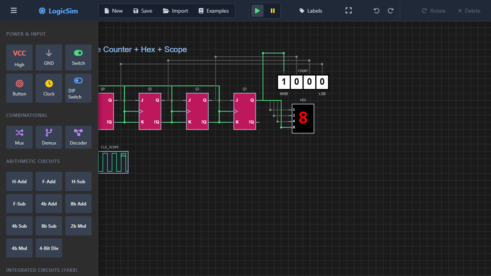

# ⚡ LogicSim3

### Build, wire, and simulate digital logic — right in your browser.

A modern, high-performance HTML5 canvas digital logic workbench. Design and explore boolean gates, multi-bit arithmetic, sequential state machines, authentic 74xx DIP ICs, and live digital instrumentation with zero installation and zero dependencies.

[**▶ Launch Live App**](https://dipankarkumarroy.github.io/LogicSim3/) · [**Output Instruments Gallery**](#-output-instruments--visualizers-gallery) · [**Circuit Examples Gallery**](#-circuit-examples-gallery) · [**Run Locally**](#-run-locally)

[](js/)
[](index.html)
[](st1.css)
[-00C853)](index.html)
[](https://dipankarkumarroy.github.io/LogicSim3/)

<br />

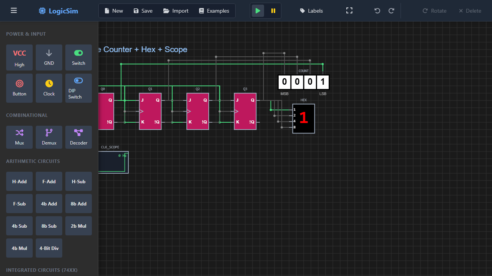

<sub>*Live interactive simulation running a synchronous counter, clock pulse generator, logic gates, hex display, CRT oscilloscope, and 16-channel logic analyzer.*</sub>

<p align="center">
  <a href="assets/banners/hero_showcase.mp4"><b>▶ Watch High-Definition Video Demo (MP4)</b></a> ·
  <a href="assets/banners/hero_showcase.png"><b>View High-Res Static Frame (PNG)</b></a>
</p>

</div>

---

## 📑 Table of Contents

- [⚡ At a Glance](#-at-a-glance)
- [📊 Output Instruments & Visualizers Gallery](#-output-instruments--visualizers-gallery)
  - [1. Indicator Light (`LIGHT`)](#1-indicator-light-light)
  - [2. Polarity-Aware LED (`LED`)](#2-polarity-aware-led-led)
  - [3. 4-Bit Hexadecimal Display (`HEX_DISPLAY`)](#3-4-bit-hexadecimal-display-hex_display)
  - [4. Multi-Segment LED Bar Graph (`BAR_GRAPH`)](#4-multi-segment-led-bar-graph-bar_graph)
  - [5. Multi-Bit Binary Digit Readout (`BITS_OUT`)](#5-multi-bit-binary-digit-readout-bits_out)
  - [6. 8x8 Multiplexed LED Matrix (`LED_MATRIX`)](#6-8x8-multiplexed-led-matrix-led_matrix)
  - [7. Real-Time Oscilloscope (`SCOPE`)](#7-real-time-oscilloscope-scope)
  - [8. 16-Channel Logic Analyzer (`ANALYZER`)](#8-16-channel-logic-analyzer-analyzer)
- [🔌 Circuit Examples Gallery](#-circuit-examples-gallery)
  - [1. 1-Bit Gate-Level Full Adder](#1-1-bit-gate-level-full-adder)
  - [2. 4-Bit Synchronous Counter + Analyzer](#2-4-bit-synchronous-counter--analyzer)
  - [3. 4-Bit JK Ripple Counter with Scope & Hex](#3-4-bit-jk-ripple-counter-with-scope--hex)
  - [4. 4-Bit Arithmetic Adder + DIP Switches & Hex](#4-4-bit-arithmetic-adder--dip-switches--hex)
  - [5. 4:1 Multiplexer & 2-to-4 Decoder with Bar Graph](#5-41-multiplexer--2-to-4-decoder-with-bar-graph)
  - [6. SN7408 Quad 2-Input AND Gate IC](#6-sn7408-quad-2-input-and-gate-ic)
  - [7. Complete Logic Gates Comparison Suite](#7-complete-logic-gates-comparison-suite)
- [🧩 Supported Component Catalog](#-supported-component-catalog)
- [🏗 Architecture & Simulation Engine](#-architecture--simulation-engine)
- [💻 Run Locally](#-run-locally)
- [🎮 Canvas Controls & Keyboard Shortcuts](#-canvas-controls--keyboard-shortcuts)
- [🚀 Deployment](#-deployment)
- [🤝 Contributing](#-contributing)

---

## ⚡ At a Glance

LogicSim3 provides a hands-on digital electronics learning laboratory directly in your browser. It simulates continuous electrical signal propagation across interconnected component pins, renders glowing high/low logic paths, detects electrical contention (short circuits), and includes benchtop analysis instruments.

### Key Highlights
- **100% Native Browser Execution**: Written in clean Vanilla ES6+ JavaScript and HTML5 Canvas. No build tools, Webpack, Node.js, or package managers required.
- **Signal-Glow Wires**: Active **HIGH** (+5V) signals radiate with an emerald green neon glow (`#4ade80`), while **LOW** (0V/GND) wires remain a muted dark gray (`#4b5563`).
- **Comprehensive Component Library**: Power sources, pushbuttons, toggle switches, clocks, logic gates, arithmetic blocks, sequential latches & flip-flops, and DIP-packaged 74xx TTL ICs.
- **Laboratory Grade Instrumentation**: Embedded single-channel digital oscilloscope with automatic frequency measurement, and a 16-channel timing logic analyzer.
- **Circuit Analysis**: Automated truth table generator with sub-circuit group isolation and canvas preview thumbnails.
- **Zero Lock-In**: Save, import, and share circuit files directly in human-readable JSON format, or load them instantaneously through URL hash fragments.

---

## 📊 Output Instruments & Visualizers Gallery

LogicSim3 includes 8 distinct output visualizers and instruments designed to inspect logic levels, binary words, alphanumeric data, and high-speed clock transitions. Every output component below features an interactive animated simulation preview, high-resolution static graphic, and dedicated video demonstration.

---

### 1. Indicator Light (`LIGHT`)

The indicator light models an incandescent lamp or single-ended logic probe. When the input reaches logic level HIGH (1 / +5V), the lamp illuminates with a warm multi-layer golden-yellow radial halo. At logic level LOW (0 / 0V), it remains an unlit dark charcoal bezel.


### 2. Polarity-Aware LED (`LED`)

Unlike simple lamps, the polarity-aware LED models an actual semiconductor diode junction. It features separate Anode (`+`, Pin 0) and Cathode (`-`, Pin 1) leads. Conduction occurs only when forward biased—requiring a HIGH potential on the Anode and a true LOW/GND return path on the Cathode.


### 3. 4-Bit Hexadecimal Display (`HEX_DISPLAY`)

An authentic 7-segment style numeric digital readout with high-contrast black enclosure. Four binary input pins weighted 1, 2, 4, and 8 are decoded in real-time to render hexadecimal digits `0` through `9` and `A` through `F`.


### 4. Multi-Segment LED Bar Graph (`BAR_GRAPH`)

A multi-segment vertical ladder display modeling industrial level meters, volume meters, and bus indicators. Each segment illuminates in glowing red when its corresponding input is asserted HIGH.


### 5. Multi-Bit Binary Digit Readout (`BITS_OUT`)

The `BITS_OUT` component provides a crisp, tile-based numeric binary representation of bus lines. Each bit is rendered within a high-contrast white card showing bold black digital `0` or `1` numerals, complete with MSB (Most Significant Bit) and LSB (Least Significant Bit) labels.


### 6. 8x8 Multiplexed LED Matrix (`LED_MATRIX`)

An 8x8 matrix display with rounded bezel modeling real-world multiplexed dot-matrix LED displays. The matrix is controlled via row anode pins ($A_0..A_7$) and column cathode pins ($C_0..C_7$). An LED dot turns ON when its row is driven HIGH and its column is pulled LOW.

| Animated Simulation (GIF) | Static Schematic (PNG) | Video Example (MP4) |
| :---: | :---: | :---: |
| 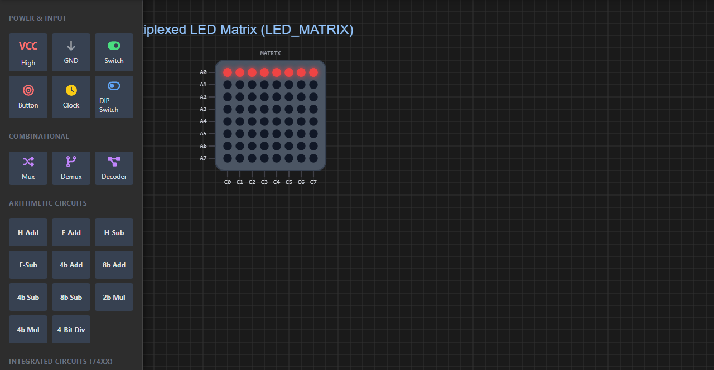 | 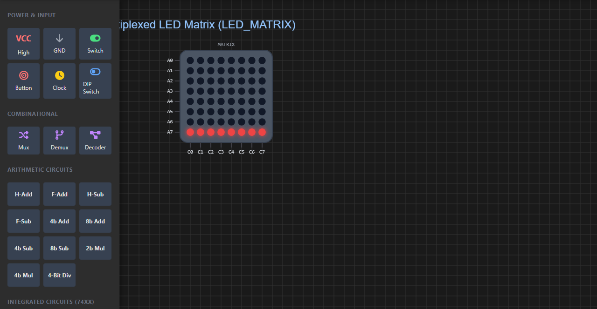 | [▶ Watch Video (MP4)](assets/outputs/led_matrix.mp4) |

- **Type ID**: `LED_MATRIX`
- **Dimensions**: Configurable $N \times N$ matrix (default $8 \times 8 = 64$ LEDs)
- **Pin Mapping**: $N$ Row Anodes ($A_0..A_{n-1}$, active HIGH) on Western side; $N$ Column Cathodes ($C_0..C_{n-1}$, active LOW) on Southern side
- **Conduction Rule**: LED $(r, c)$ illuminates if and only if $Row_r == 1$ and $Col_c == 0$
- **Common Usage**: Multiplexed display scanning, scrolling text character generators, graphical sprites

---

### 7. Real-Time Oscilloscope (`SCOPE`)

An oscilloscope instrument that samples digital signal transitions in real-time, advances a continuous scrolling square-wave trace on an phosphor CRT screen, and measures clock period to compute live frequency readouts.


### 8. 16-Channel Logic Analyzer (`ANALYZER`)

The logic analyzer provides a benchtop multi-line timing instrument. With 16 synchronized digital input channels (`0` through `F`), it records state transitions simultaneously and visualizes complex timing relationships, bus transitions, and clock divider cascades.


## 🔌 Circuit Examples Gallery

LogicSim3 includes a curated collection of pre-built, importable digital circuits located in the [`Examples/`](Examples/) directory. You can load any of these circuits directly from the in-app **Examples** menu or by appending `#Examples/<filename>.json` to the URL.

---

### 1. 1-Bit Gate-Level Full Adder

A classic digital arithmetic circuit demonstrating multi-input addition. Two XOR gates produce the Sum bit; two AND gates and an OR gate compute the Carry-Out bit.

| Animated Simulation (GIF) | Static Schematic (PNG) | Circuit File & Video |
| :---: | :---: | :---: |
| 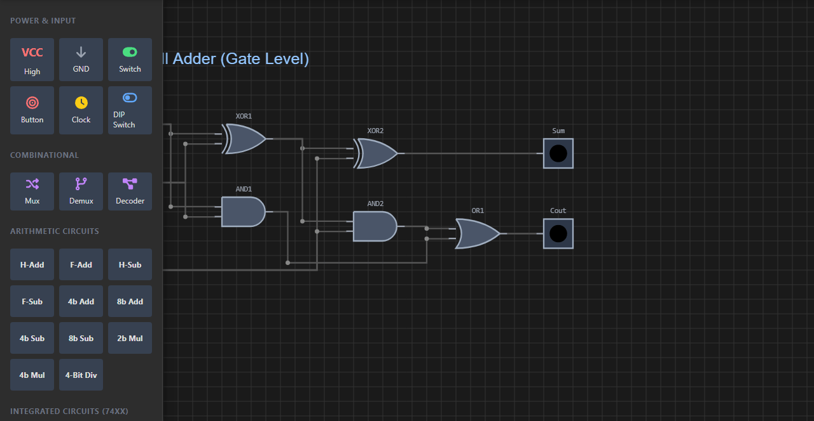 | 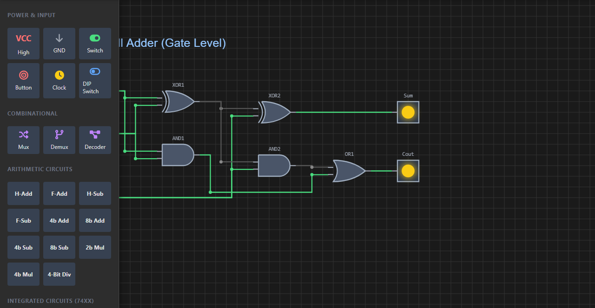 | [`Examples/full_adder.json`](Examples/full_adder.json)<br />[▶ Watch Video (MP4)](assets/circuits/full_adder.mp4) |

#### Schematic Flow
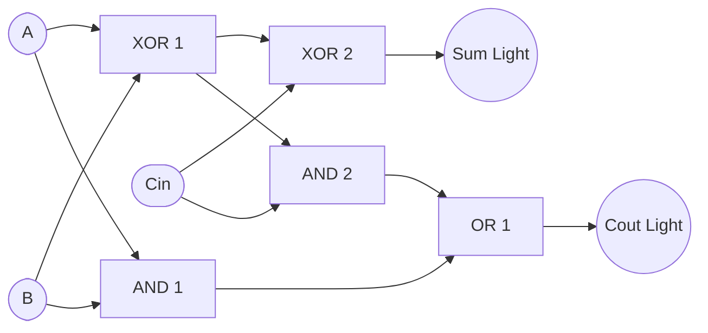

#### Full Adder Truth Table
| A | B | Cin | Sum ($A \oplus B \oplus Cin$) | Carry Out ($AB + Cin(A \oplus B)$) |
| :-: | :-: | :-: | :-: | :-: |
| 0 | 0 | 0 | **0** | **0** |
| 0 | 0 | 1 | **1** | **0** |
| 0 | 1 | 0 | **1** | **0** |
| 0 | 1 | 1 | **0** | **1** |
| 1 | 0 | 0 | **1** | **0** |
| 1 | 0 | 1 | **0** | **1** |
| 1 | 1 | 0 | **0** | **1** |
| 1 | 1 | 1 | **1** | **1** |

---

### 2. 4-Bit Synchronous Counter + Analyzer

A synchronous binary up-counter constructed with 4 edge-triggered D flip-flops, steering logic gates, and a master clock generator, wired directly into a 16-channel logic analyzer to verify simultaneous register state changes.

| Animated Simulation (GIF) | Static Schematic (PNG) | Circuit File & Video |
| :---: | :---: | :---: |
| 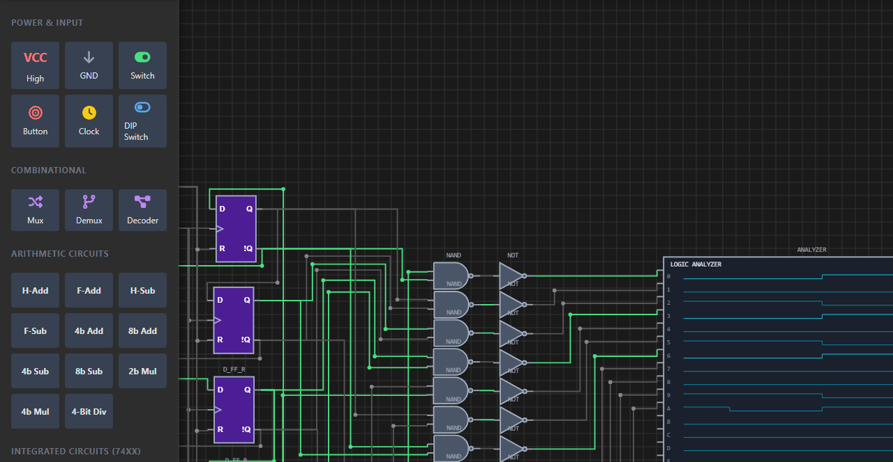 | 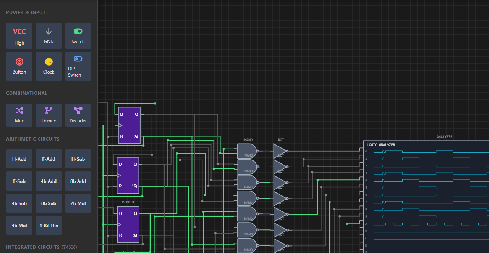 | [`Examples/counter.json`](Examples/counter.json)<br />[▶ Watch Video (MP4)](assets/circuits/counter_4bit.mp4) |

- **Components**: 4 D Flip-Flops, AND Gates, XOR Gates, Master Clock, 16-Ch Logic Analyzer
- **Behavior**: All flip-flops trigger simultaneously on the rising clock edge, eliminating ripple propagation skew
- **Analyzer Output**: Channels $Q_0$ through $Q_3$ display binary division ratios ($f/2, f/4, f/8, f/16$)

---

### 3. 4-Bit JK Ripple Counter with Scope & Hex

An asynchronous binary ripple counter built from cascaded negative-edge triggered JK flip-flops. Each stage has $J=1$ and $K=1$ configured in toggle mode. The inverted output $Q'$ of each stage clocks the subsequent flip-flop, driving both a Hex Display and an Oscilloscope.

| Animated Simulation (GIF) | Static Schematic (PNG) | Circuit File & Video |
| :---: | :---: | :---: |
|  | 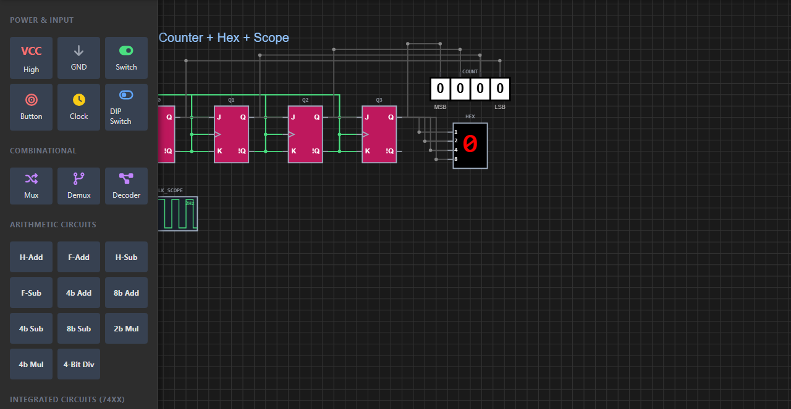 | [`Examples/jk_ripple_counter.json`](Examples/jk_ripple_counter.json)<br />[▶ Watch Video (MP4)](assets/circuits/jk_ripple_counter.mp4) |

- **Components**: 4 JK Flip-Flops, Clock, VCC Power, Hex Display, Scope, Binary Readout
- **Counting Sequence**: `0x0`, `0x1`, `0x2`, ..., `0xE`, `0xF` (0 to 15 decimal rollover)
- **Oscilloscope Inspection**: Measures input clock against stage 0 toggle frequency

---

### 4. 4-Bit Arithmetic Adder + DIP Switches & Hex

A multi-bit parallel arithmetic testbench. Two 4-bit DIP switches provide inputs for Operands $A$ and $B$. A 4-bit parallel adder block computes the binary sum, driving both a `BITS_OUT` parallel readout, a `HEX_DISPLAY` result, and an overflow Carry lamp.

| Animated Simulation (GIF) | Static Schematic (PNG) | Circuit File & Video |
| :---: | :---: | :---: |
|  | 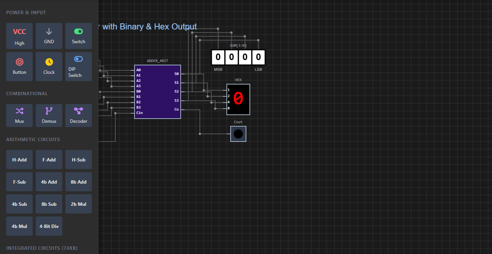 | [`Examples/adder_4bit_hex.json`](Examples/adder_4bit_hex.json)<br />[▶ Watch Video (MP4)](assets/circuits/adder_4bit_hex.mp4) |

- **Operands**: $A[3..0]$ (0..15) and $B[3..0]$ (0..15) configured via dual DIP switch banks
- **Outputs**: 4-bit sum ($S[3..0]$) decoded onto Hexadecimal Display, with Carry-Out driving an overflow indicator light
- **Interactive Verification**: Try setting $A = 7$ and $B = 9$ to observe Sum $= 0$ and Carry $= 1$ ($16_{10} = 0x10$)

---

### 5. 4:1 Multiplexer & 2-to-4 Decoder with Bar Graph

Demonstrates combinational data routing and address decoding. Two select switches ($S_0, S_1$) drive a 2-to-4 active-high decoder (asserting exactly one line $Y_0..Y_3$) and simultaneously configure a 4:1 Multiplexer steering data into a multi-segment LED Bar Graph.

| Animated Simulation (GIF) | Static Schematic (PNG) | Circuit File & Video |
| :---: | :---: | :---: |
|  | 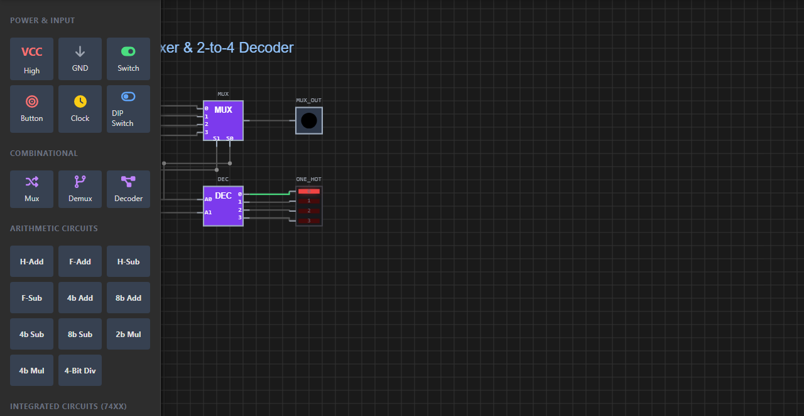 | [`Examples/mux_decoder_demo.json`](Examples/mux_decoder_demo.json)<br />[▶ Watch Video (MP4)](assets/circuits/mux_decoder.mp4) |

- **Components**: 4:1 Multiplexer, 2:4 Line Decoder, 2 Select Switches, 4 Data Inputs, LED Bar Graph
- **Decoding Rule**: $[S_1, S_0] = [0, 0] \rightarrow Y_0$; $[0, 1] \rightarrow Y_1$; $[1, 0] \rightarrow Y_2$; $[1, 1] \rightarrow Y_3$
- **Bar Graph Feedback**: Visualizes one-hot channel assertion and data path transmission

---

### 6. SN7408 Quad 2-Input AND Gate IC

Demonstrates authentic TTL 74xx Dual-In-Line (DIP-14) integrated circuit emulation. The IC requires active power connections on Pin 14 ($V_{CC} = +5V$) and Pin 7 ($GND = 0V$) before its internal AND gates will operate, driving a polarity-aware red LED.

| Animated Simulation (GIF) | Static Schematic (PNG) | Circuit File & Video |
| :---: | :---: | :---: |
| 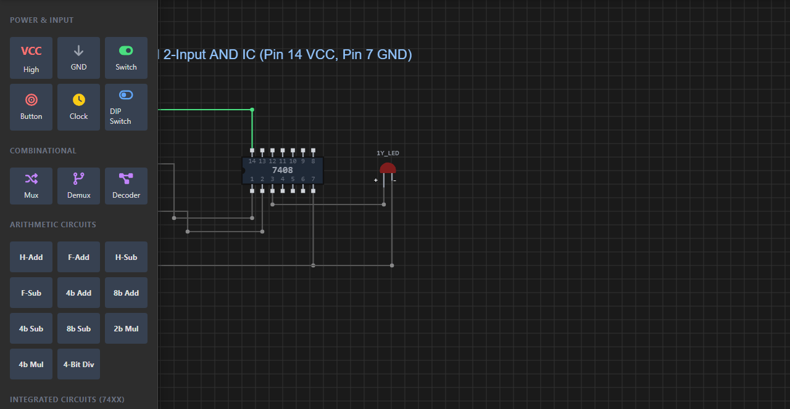 | 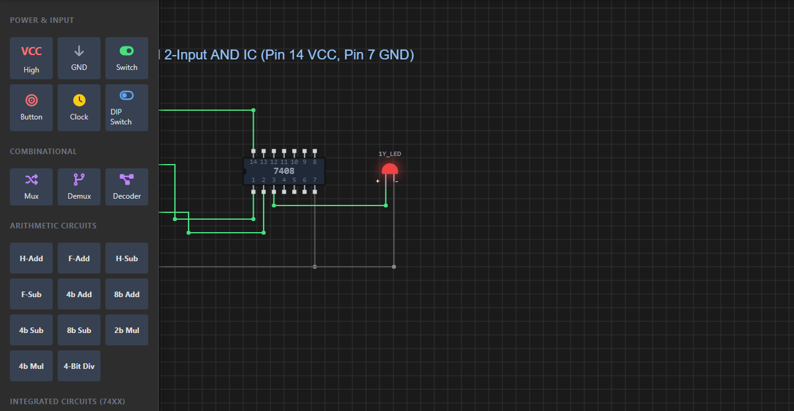 | [`Examples/ic7408_and_gate.json`](Examples/ic7408_and_gate.json)<br />[▶ Watch Video (MP4)](assets/circuits/ic7408_and.mp4) |

- **IC Model**: Standard Texas Instruments SN7408N DIP-14 pinout
- **Power Rail Verification**: Pin 14 ($V_{CC}$) and Pin 7 ($GND$) are actively enforced by the engine
- **Gate 1 Pinout**: Inputs on Pin 1 ($1A$) and Pin 2 ($1B$), output on Pin 3 ($1Y$)
- **Output Indicator**: Polarity-aware LED with forward-biased return path to ground

---

### 7. Complete Logic Gates Comparison Suite

A parallel test suite evaluating all 7 fundamental boolean logic gates under identical input conditions. Toggle switches $A$ and $B$ simultaneously drive AND, OR, NOT, XOR, NAND, NOR, and XNOR gates, with live indicator lights displaying the boolean result.

| Animated Simulation (GIF) | Static Schematic (PNG) | Circuit File & Video |
| :---: | :---: | :---: |
|  | 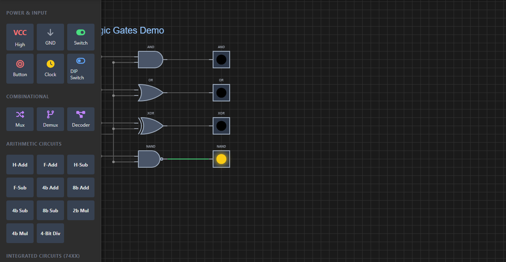 | [`Examples/logic_gates_demo.json`](Examples/logic_gates_demo.json)<br />[▶ Watch Video (MP4)](assets/circuits/logic_gates.mp4) |

- **Gates Evaluated**: `AND`, `OR`, `NOT`, `XOR`, `NAND`, `NOR`, `XNOR`
- **Interactive Verification**: Quickly observe De Morgan's equivalences and inverted gate outputs
- **Truth Table Integration**: Open the in-app **Table** modal to auto-generate the complete truth table

---

## 🧩 Supported Component Catalog

| Category | Component Identifier | Description & Ports |
| :--- | :--- | :--- |
| **Power & Ground** | `VCC`, `GND` | Fixed $+5\text{V}$ logic HIGH source and $0\text{V}$ ground reference sink. |
| **User Inputs** | `SWITCH`, `BUTTON` | Bistable toggle switch and momentary push button with visual state slider. |
| **Signal Generators** | `CLOCK` | Square-wave pulse source with configurable frequency ($0.1\text{ Hz}$ to $1000\text{ Hz}$). |
| **Bus Inputs** | `DIP_SWITCH` | Multi-lane dual-in-line switch bank (configurable 4, 8, 16 bits). |
| **Basic Gates** | `AND`, `OR`, `NOT` | Standard boolean gates with IEEE compliant schematic outlines. |
| **Inverted Gates** | `NAND`, `NOR`, `XNOR` | Inverting boolean gates equipped with output inversion bubbles. |
| **Exclusive Gates** | `XOR` | Dual-input exclusive OR gate for parity and addition circuits. |
| **Multiplexers** | `MUX`, `DEMUX` | $2^n:1$ data selector and $1:2^n$ data distributor blocks. |
| **Decoders** | `DECODER` | Binary $n$-to-$2^n$ one-hot decoder block. |
| **Adders & Subtractors** | `HALF_ADDER`, `FULL_ADDER`, `ADDER_4`, `ADDER_8` | 1-bit, 4-bit, and 8-bit parallel arithmetic addition blocks with carry handling. |
| **Multipliers & Dividers**| `MULTIPLIER_2`, `MULTIPLIER_4`, `DIVIDER_4` | Hardware combinational multiplication and division components. |
| **Flip-Flops & Latches** | `D_FF`, `T_FF`, `JK_FF`, `SR_FF` | Edge-triggered sequential memory elements with clock arrow and inverted outputs. |
| **74xx Series ICs** | `7400`, `7402`, `7404`, `7408`, `7432`, `7483`, `7486`, `74150`, `74151` | Authentic DIP-packaged TTL integrated circuits with standard pinouts and rail verification. |
| **Visual Indicators** | `LIGHT`, `LED`, `BAR_GRAPH` | Incandescent indicator lamp, polarity-aware LED, and 10-segment LED ladder. |
| **Numeric Readouts** | `HEX_DISPLAY`, `BITS_OUT` | 7-segment ruby-red hex display and multi-bit parallel binary digit cards. |
| **Matrix Displays** | `LED_MATRIX` | $N \times N$ multiplexed dot-matrix display with row anodes and column cathodes. |
| **Benchtop Instruments**| `SCOPE`, `ANALYZER` | CRT square-wave oscilloscope and 16-channel timing logic analyzer. |
| **Schematic Tools** | `TEXT` | Movable schematic text annotations with customizable font sizes and colors. |

---

## 🏗 Architecture & Simulation Engine

The simulator is built with a decoupled, modular Vanilla JavaScript architecture:

```text
index.html                  Layout, component sidebar, toolbar, canvas container
ui.js                       Sidebar category collapse, fullscreen toggle, example modal
st1.css, st2.css, st3.css    Icons, workbench layout, typography, UI styling
examples.json               Catalog of built-in circuit examples with metadata
Examples/                   Pre-built JSON circuit designs
assets/
  banners/                  Hero banner and animated workbench showcase (.png, .gif, .mp4)
  outputs/                  Individual output visualizer media (.png, .gif, .mp4)
  circuits/                 Individual circuit example media (.png, .gif, .mp4)
scripts/
  generate_all_assets.py    Python media pipeline (OpenCV, Pillow) to render images & videos
js/
  main.js                   Application entry point; instantiates LogicSimulator on DOM ready
  components/
    BaseComponent.js        Shared port geometry, coordinate transforms, selection & drawing
    ComponentRegistry.js    Extensible registry mapping type strings to component classes
    inputs/                 Power sources (VCC/GND), switches, buttons, clocks, DIP switches
    gates/                  LogicGateComponent (AND, OR, NOT, NAND, NOR, XOR, XNOR)
    plexers/                Multiplexer, Demultiplexer, Decoder
    arithmetic/             Adders, Subtractors, Multipliers, Dividers
    flipflops/              D, T, JK, and SR flip-flops with clock edge detection
    ics/                    DIP-14 and DIP-16 physical 74xx IC packages
    outputs/                Light, LED, Hex Display, Bar Graph, Bits Out, LED Matrix
    analysis/               Scope, Logic Analyzer, WaveformChannel circular buffer
    tools/                  Canvas text annotations
  simulator/
    LogicSimulator.js       Main simulation loop, wire propagation, electrical contention
    CanvasRenderer.js       World-to-screen matrix transform, grid, wire glow, selection box
    InputHandler.js         Mouse/touch interactions, dragging, wire routing, shortcuts
    Serializer.js           JSON circuit serialization, URL hash loader, file import/export
    TruthTableGenerator.js  Circuit graph traversal, input permutation, truth table modal
    HistoryManager.js       Undo/redo transaction stack
    Geometry.js             Orthogonal wire routing and geometric collision utilities
```

### Runtime Propagation Flow
1. **RequestAnimationFrame Loop**: `LogicSimulator.update()` ticks the simulation clock and advances oscilloscope/analyzer buffers.
2. **Propagation Pass (`runPropagationPass()`)**:
   - Computes wire connection states from source component output ports.
   - Updates input contention maps (`hasHigh`, `hasLow`) for every pin.
   - Detects electrical short-circuits (e.g., competing HIGH and LOW drives on the same node), immediately pausing the simulation and flagging the contention site.
   - Calls `calculate()` on all connected components to propagate logic outputs.
3. **Canvas Rendering (`CanvasRenderer.draw()`)**:
   - Applies viewport scale and pan offsets.
   - Draws the background coordinate grid.
   - Renders orthogonal wire paths with neon glow styling for asserted lines.
   - Draws components, pin connection terminals, and floating labels.

---

## 💻 Run Locally

LogicSim3 requires **no build step, no compiler, and zero dependencies**. Because modern browsers restrict `fetch()` requests on `file:///` URLs (needed to load `examples.json` and JSON circuit files), serve the repository root with any lightweight static HTTP server:

### Option 1: Python 3 (Recommended)
```bash
# Clone the repository
git clone https://github.com/dipankarkumarroy/LogicSim3.git
cd LogicSim3

# Start static HTTP server
python3 -m http.server 8000
```
Then navigate to: **`http://localhost:8000`**

### Option 2: Node.js `npx serve`
```bash
npx serve .
```

### Option 3: VS Code Live Server
Right-click `index.html` in VS Code and select **"Open with Live Server"**.

---

## 🎮 Canvas Controls & Keyboard Shortcuts

| Action | Shortcut / Gesture | Description |
| :--- | :--- | :--- |
| **Select / Move** | `Left Click` + Drag | Select components or drag them across the canvas grid. |
| **Box Select** | `Click + Drag` on empty canvas | Create a rectangular selection marquee around multiple components. |
| **Draw Wire** | `Click` on output pin $\rightarrow$ `Click` on input pin | Connects two ports with automatic orthogonal wire routing. |
| **Pan Canvas** | `Right Click` + Drag or `Middle Click` | Pan the viewport across large schematics. |
| **Zoom View** | `Mouse Wheel` | Zoom in and out centered on cursor position. |
| **Rotate** | <kbd>R</kbd> or Toolbar Rotate | Rotate selected component by $90^\circ$ clockwise. |
| **Delete** | <kbd>Delete</kbd> or <kbd>Backspace</kbd> | Delete selected components and attached wires. |
| **Undo / Redo** | <kbd>Ctrl</kbd> + <kbd>Z</kbd> / <kbd>Ctrl</kbd> + <kbd>Y</kbd> | Revert or re-apply canvas editing transactions. |
| **Copy / Paste** | <kbd>Ctrl</kbd> + <kbd>C</kbd> / <kbd>Ctrl</kbd> + <kbd>V</kbd> | Duplicate selected circuit sub-graphs. |
| **Toggle Simulation**| Toolbar **Play / Pause** | Toggle active electrical signal propagation. |
| **Truth Table** | Toolbar **Table** | Automatically generate and view truth table for connected circuits. |
| **Context Menu** | `Right Click` on component | Configure bit-widths, frequencies, rename labels, or inspect pins. |

---

## 🚀 Deployment

The repository includes a GitHub Actions workflow located at [`.github/workflows/static.yml`](.github/workflows/static.yml). Any push to the `main` branch automatically deploys the latest version to GitHub Pages:

```yaml
# Deploys static files to GitHub Pages
permissions:
  contents: read
  pages: write
  id-token: write
```

To enable GitHub Pages for your fork:
1. Navigate to **Settings** $\rightarrow$ **Pages** in your repository.
2. Under **Build and deployment** $\rightarrow$ **Source**, choose **GitHub Actions**.

---

## 🤝 Contributing

Contributions, feature suggestions, and new example circuits are always welcome!

1. **Fork the Repository**
2. **Create your Feature Branch**: `git checkout -b feature/awesome-component`
3. **Add your Component**: Register it in `js/components/` following `BaseComponent` conventions.
4. **Create an Example**: Save a demonstration circuit in `Examples/<your_example>.json` and register it in `examples.json`.
5. **Update Media**: Run `python scripts/generate_all_assets.py` to regenerate graphics, GIFs, and videos.
6. **Commit and Push**: `git commit -m "Add 4-bit Magnitude Comparator"` $\rightarrow$ `git push origin feature/awesome-component`
7. **Open a Pull Request**

---

<div align="center">

Made with ❤️ by **D K Roy** · [GitHub Repository](https://github.com/dipankarkumarroy/LogicSim3)

<sub>LogicSim3 is open source under the MIT License.</sub>

</div>
