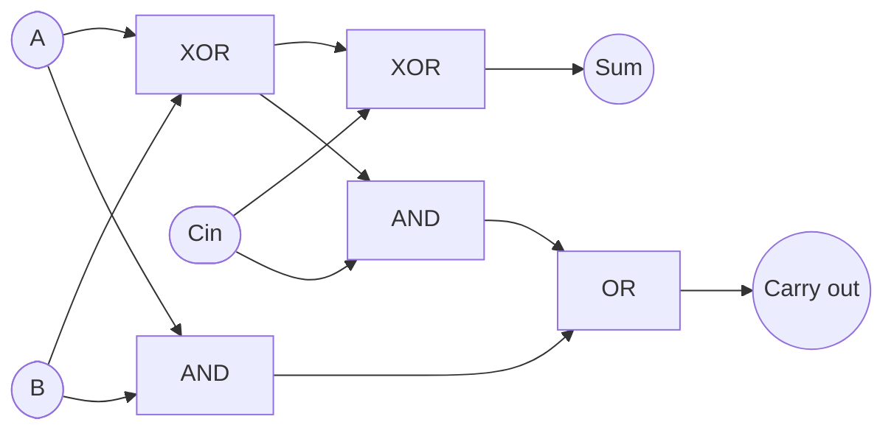

<div align="center">

# ⚡ LogicSim3

### Build, wire, and simulate digital logic — right in your browser.

A canvas-based logic circuit workbench for exploring gates, arithmetic, sequential logic, 74xx ICs, and digital signals. No install or build step is required: serve the static files and open the app.

[**▶ Open LogicSim3**](https://dipankarkumarroy.github.io/LogicSim3/) · [**Explore example circuits**](#example-circuits) · [**Run locally**](#run-locally)


</div>

---

## At a glance

LogicSim3 is a digital logic simulator and visual learning tool. Assemble circuits on an interactive canvas, run them live, and inspect outputs as logic levels, displays, or waveforms. The project is implemented with browser-native HTML, CSS, JavaScript, and Canvas—there is no framework, package manager, or compilation stage.

## What you can build

| Circuit area | Available components and examples |
| --- | --- |
| **Inputs & power** | VCC, GND, switches, momentary buttons, clocks, DIP switches |
| **Logic** | AND, OR, NOT, NAND, NOR, XOR, XNOR |
| **Combinational blocks** | Multiplexer, demultiplexer, decoder |
| **Arithmetic** | Half/full adders and subtractors; 4- and 8-bit adders/subtractors; 2- and 4-bit multipliers; 4-bit divider |
| **Sequential logic** | D, resettable D, T, JK, and SR flip-flops |
| **74xx ICs** | 7400, 7402, 7404, 7408, 7432, 7483, 7486, 74150, 74151 |
| **Outputs & instruments** | Light, polarity-aware LED, hexadecimal display, bar graph, bit output, LED matrix, oscilloscope, logic analyzer |
| **Analysis & editing** | Truth-table generator, circuit thumbnails, labels, text annotations, undo/redo, copy/paste, rotate, zoom/pan, JSON import/export |

## Graphical examples

### Full-adder signal path

This schematic illustrates the gate-level full-adder example shipped in [`Examples/full_adder.json`](Examples/full_adder.json). Two XOR gates produce the sum; two AND gates and an OR gate produce carry-out.



| A | B | Cin | Sum | Carry out |
| :-: | :-: | :-: | :-: | :-: |
| 0 | 0 | 0 | 0 | 0 |
| 0 | 0 | 1 | 1 | 0 |
| 0 | 1 | 0 | 1 | 0 |
| 0 | 1 | 1 | 0 | 1 |
| 1 | 0 | 0 | 1 | 0 |
| 1 | 0 | 1 | 0 | 1 |
| 1 | 1 | 0 | 0 | 1 |
| 1 | 1 | 1 | 1 | 1 |

The simulator can generate truth tables for connected groups that include supported inputs and outputs. Its analysis modal also renders a small canvas thumbnail of each eligible circuit group.

### Output and instrument gallery

The simulator draws these outputs directly on its canvas. The examples below describe the available visualizations; they are not screenshot assets.

| Output | What it visualizes |
| --- | --- |
| **Light / LED** | A lit indicator for a high input; the LED also models polarity and requires its return connection. |
| **Hex display** | A hexadecimal digit derived from a multi-bit input. |
| **Bar graph / Bits Out** | Multi-bit values as individual visual bit levels. |
| **LED matrix** | A grid of individually driven LEDs. |
| **Scope** | A scrolling digital trace with an estimated frequency readout. |
| **Analyzer** | Multiple digital signal traces for comparing circuit signals over time. |

### Waveform concept

Scope and Analyzer record signal transitions and render square-wave traces. This small, static timing sketch explains the kind of signal being inspected; the live trace is drawn in the app.

```text
Clock   _|‾|_|‾|_|‾|_|‾|_
Q       ___|‾‾‾‾|___|‾‾‾‾
          time ──────────▶
```

## Example circuits

Choose **Examples** in the toolbar to load a sample circuit, or open a JSON circuit directly using the URL-hash loader.

| Example | What to explore | Circuit file |
| --- | --- | --- |
| **Basic Logic Gates** | Compare AND, OR, XOR, and NAND with switches, lights, and the truth-table tool. | [`Examples/logic_gates_demo.json`](Examples/logic_gates_demo.json) |
| **1-Bit Full Adder** | Follow sum and carry through a gate-level circuit. | [`Examples/full_adder.json`](Examples/full_adder.json) |
| **4-Bit Counter** | Observe a clocked counter built from flip-flops and gates; inspect its analyzer signals. | [`Examples/counter.json`](Examples/counter.json) |
| **4-Bit Adder + Hex Display** | Set two DIP-switch operands and inspect the result and carry. | [`Examples/adder_4bit_hex.json`](Examples/adder_4bit_hex.json) |
| **4-Bit JK Ripple Counter** | Explore a JK-flip-flop counter with a hexadecimal display and scope. | [`Examples/jk_ripple_counter.json`](Examples/jk_ripple_counter.json) |
| **4:1 MUX & 2-to-4 Decoder** | See data selection and one-hot decoding with switch inputs and a bar graph. | [`Examples/mux_decoder_demo.json`](Examples/mux_decoder_demo.json) |
| **7408 Quad AND IC** | Power a 7408 and test an AND output with a polarity-aware LED. | [`Examples/ic7408_and_gate.json`](Examples/ic7408_and_gate.json) |

The sample list is maintained in [`examples.json`](examples.json). Circuit files are JSON and can also be saved from the app, imported, or loaded by URL hash. For example, append `#Examples/full_adder.json` to the app URL.

## How the simulator is organized

```text
index.html                 App layout, toolbar, component palette, script loading
ui.js                      Sidebar, fullscreen, and example-browser UI
st1.css, st2.css, st3.css   Icon styles, layout styles, generated utility styles
examples.json              Example titles, descriptions, and circuit links
Examples/                  Saved, importable JSON circuit designs
js/
  main.js                  Creates the LogicSimulator after DOM content loads
  components/
    BaseComponent.js       Shared component ports, state, geometry, and drawing helpers
    ComponentRegistry.js   Maps circuit type identifiers to component classes
    inputs/ gates/         Power, switches, clock, and Boolean gates
    plexers/ arithmetic/   Multiplexers, decoder, and arithmetic blocks
    flipflops/ ics/        Stateful logic and 74xx DIP ICs
    outputs/ analysis/     Indicators, displays, scopes, and analyzer
    tools/                 Canvas text annotations
  simulator/
    LogicSimulator.js      Simulation loop, propagation, state and orchestration
    CanvasRenderer.js      Canvas grid, wires, components, and visual indicators
    InputHandler.js        Canvas interaction and editing events
    Serializer.js          JSON import/export and URL-hash circuit loading
    TruthTableGenerator.js Connected-circuit analysis and truth-table rendering
    HistoryManager.js      Undo/redo history
    Geometry.js            Shared geometry helpers
```

### Runtime flow

`js/main.js` creates `LogicSimulator` after the page loads. The simulator owns circuit state and advances its animation-frame loop; `runPropagationPass()` transfers wire values and asks components to calculate outputs. `CanvasRenderer` draws the grid, signal-colored wires, and components. Component classes register with `ComponentRegistry`, while `Serializer` and `TruthTableGenerator` handle circuit persistence and analysis.

## Run locally

There is no build or dependency-install step. Because example circuits and the example catalog are fetched as JSON, use a local HTTP server rather than opening `index.html` as a `file://` URL.

```bash
git clone https://github.com/dipankarkumarroy/LogicSim3.git
cd LogicSim3
python3 -m http.server 8000
```

Then visit <http://localhost:8000> in a modern browser. If Python is unavailable, any static web server that serves the repository root will work.

### First circuit

1. Start the local server and open the app.
2. Select **Examples** and choose **1-Bit Full Adder**, or add switches, gates, and lights from the sidebar.
3. Draw connections between component pins on the canvas.
4. Use **Play** and **Pause** to control the simulation; toggle input switches to change the logic levels.
5. Open **Table** to generate a truth table for an eligible connected circuit.
6. Use **Save** to download a JSON circuit, or **Import** to load one.

## Interactions and behavior

- **Canvas:** Place, select, move, wire, and rotate components; pan and zoom to work on larger designs.
- **Toolbar:** Create, save, and import circuits; browse examples; play/pause simulation; toggle labels and fullscreen; undo/redo; rotate or delete the selection.
- **Context menu:** Access component or wire actions such as rename, label visibility, frequency/bit-size controls where supported, and delete.
- **Safety feedback:** Conflicting HIGH/LOW drives are detected at inputs; the simulation pauses and marks the short-circuit location.
- **Clocks and instruments:** Clock frequency is configurable; scopes/analyzers sample transitions during simulation and display frequency information.

## Deployment

The repository includes a GitHub Actions workflow at [`.github/workflows/static.yml`](.github/workflows/static.yml) that deploys the repository's static content to GitHub Pages when changes are pushed to `main`, and supports manual runs from Actions. The deployment requires GitHub Pages to be enabled and configured for the workflow in repository settings.

## Contributing

Improvements are welcome. Keep new component types consistent with the registry-based component structure, add or update example JSON when a feature benefits from a demo, and update this README when the UI or supported components change. There is currently no package manifest or automated test command in the repository.

---

<div align="center">

Made by **D K Roy** · [Repository](https://github.com/dipankarkumarroy/LogicSim3)

</div>
